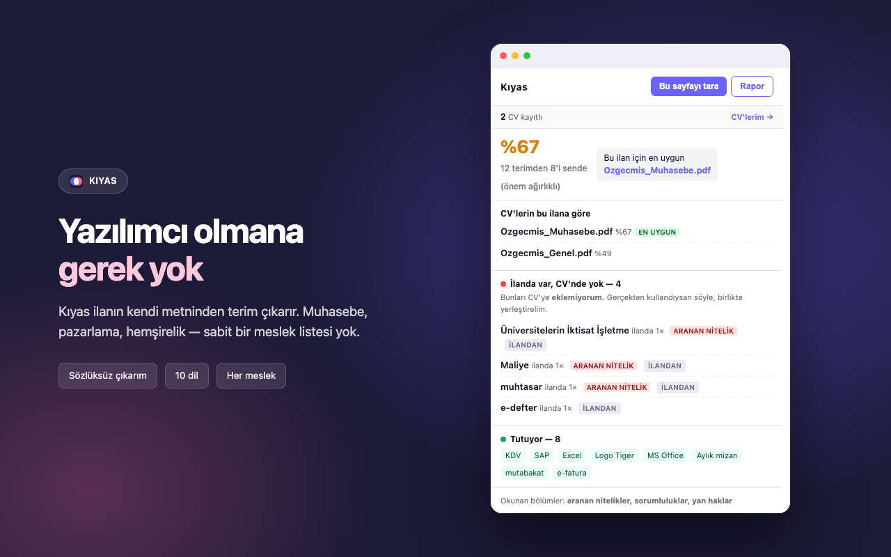
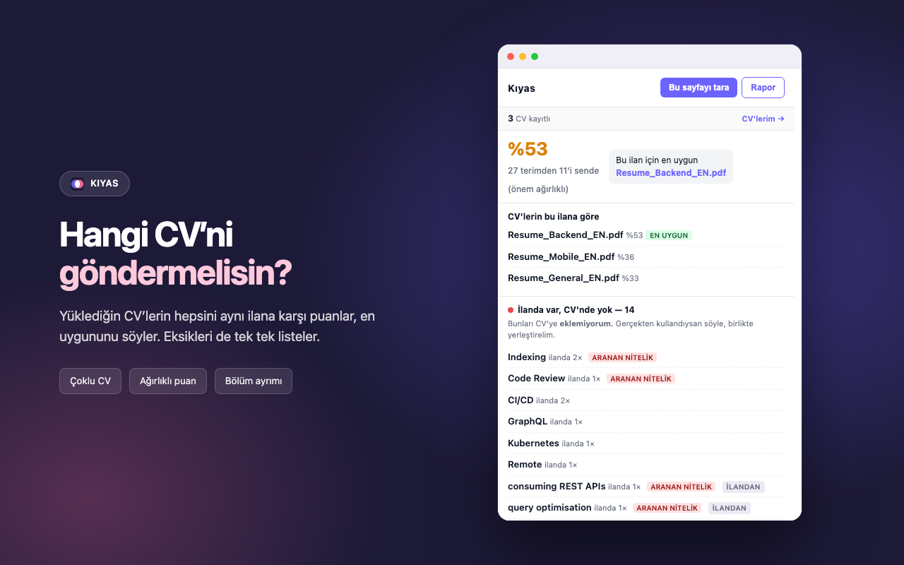
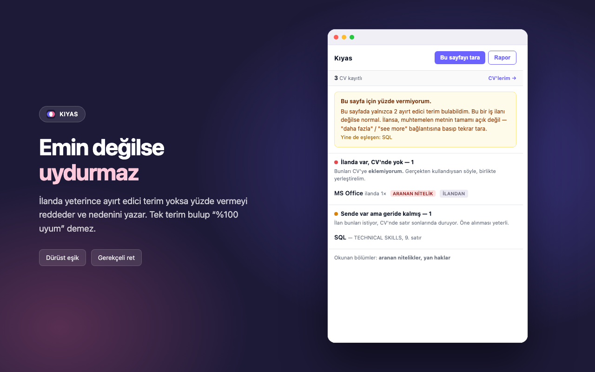
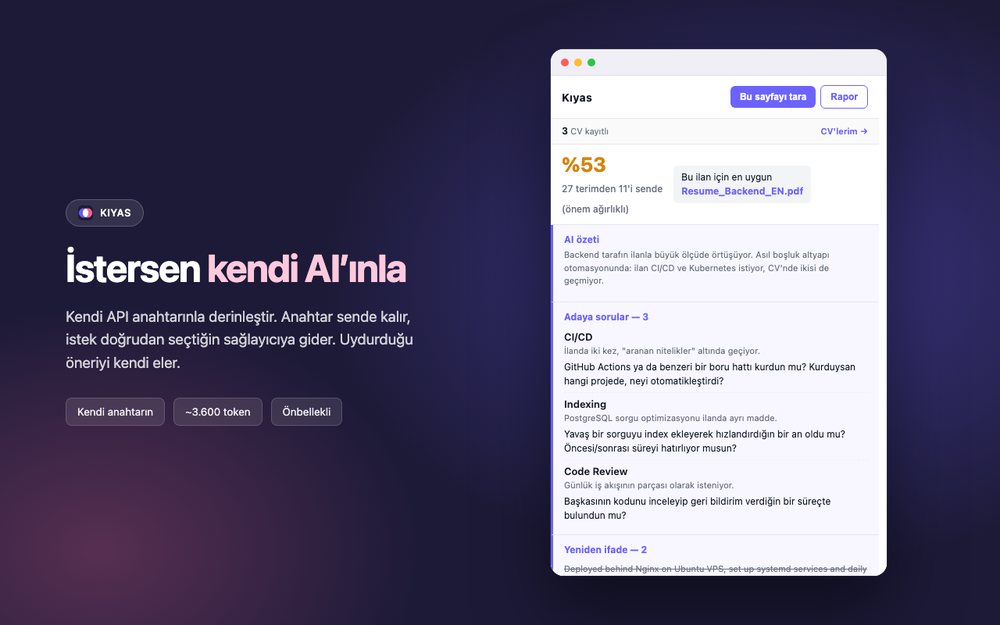

  

<h1 align="center">Kıyas</h1>

  İş ilanını CV'lerinle karşılaştıran Chrome eklentisi. 
  Hangi terim eksik, hangisi CV'nde var ama geride kalmış — tek tek söyler. 
  <b>CV'ne hiçbir şey eklemez, hiçbir şey uydurmaz.</b>

  <a href="https://kursaderen.github.io/kiyas/gizlilik.html">Gizlilik politikası</a> ·
  <a href="https://github.com/KursadEren/kiyas/releases/latest">İndir</a>

---

## Yazılımcı olmana gerek yok

Sabit bir meslek listesi yok. Kıyas ilanın **kendi metninden** ayırt edici
terimleri çıkarır: muhasebede `mizan`, `e-fatura`, `muhtasar beyanname`;
pazarlamada `Google Ads`, `SEO`, `Salesforce CRM`; hemşirelikte `triyaj`,
`HBYS`, `İleri Kardiyak Yaşam Desteği`.

Yukarıdaki ekran görüntüsü gerçek: tamamen Türkçe bir muhasebe ilanı,
sözlükte tek bir muhasebe terimi olmadan %67 eşleşme.

### Dolgu nasıl eleniyor

Her ilan "takım çalışmasına yatkın, iletişimi güçlü" der. Bu cümle hiçbir
adayı diğerinden ayırmaz, o yüzden terim sayılmamalı. Üç elek:

| Elek | Ne eler | Kaynak |
|---|---|---|
| Sıklık listesi | Gündelik dilde zaten yaygın kelimeler | Dil başına en sık 8.000 kelime |
| İK dolgu listesi | İlanlara özgü kalıp dil: *yetkinlik, tercihen, proactive, stakeholders* | El yazımı, 10 dil |
| Yapısal kurallar | Şirket tanıtımı ve yan haklar blokları, eylem adları, tek geçişlik zayıf sinyal | — |

Eşik ölçülerek seçildi: Türkçede *deneyim* 7.555'inci sırada (dolgu),
*muhasebe* 16.822'nci (terim). İngilizcede *communication* 3.999 (dolgu),
*payroll* 9.330 (terim). 8.000 ikisini ayıran yer.

Türkçe sondan eklemeli olduğu için ek ayıklayıcı var: liste `plan`ı biliyor,
`planına`yı bilmiyor. Geri izlemeli olarak ekleri soyup kökü arıyor.

---

## Hangi CV'ni göndermelisin?

Birden fazla CV yükle; hepsini aynı ilana karşı puanlar, en uygununu söyler.
Üç liste çıkarır:

- **İlanda var, CV'nde yok** — eklemez, *"bunu gerçekten kullandın mı?"* diye sorar
- **Sende var ama geride kalmış** — CV'nin alt satırlarında kalmış, öne alman yeterli
- **Bu ilan için ölü ağırlık** — ilanda hiç geçmiyor ama CV'nde önde duruyor

İlanın bölümlerini ayırt eder: *aranan nitelikler* 3×, *sorumluluklar* 2×,
*tercihen* 1.5× ağırlık alır. Şirket tanıtımı ve yan haklar 0.2× — oradaki
kelimeler puanı şişirmesin diye.

---

## Emin değilse uydurmaz

İlanda yeterince ayırt edici terim yoksa yüzde vermeyi **reddeder** ve nedenini
yazar. Bir terim bulup onu da bilmek "%100 uyum" değildir.

---

## İstersen kendi AI'ınla

Kutudan çıktığı haliyle AI olmadan çalışır. İstersen kendi API anahtarını
girersin — Anthropic, OpenAI, Gemini ya da kendi uç noktan (Ollama, şirket içi
ağ geçidi).

- Anahtar **sende kalır**; istek doğrudan senin seçtiğin sağlayıcıya gider, aradan geçen sunucumuz yok
- Her çağrıdan önce **kaç token harcanacağını gösterip onay ister**
- Aynı ilan + aynı CV ikinci kez **ücretsiz** (önbellekten)
- Modelin uydurduğu öneriyi **kendi eler**: CV'de geçmeyen teknoloji içeren öneri gösterilmez

Analiz başına ~3.600 token. Gemini Flash ile tarama başına yaklaşık **$0,0006**.

---

## Kurulum

[Son sürümü indir](https://github.com/KursadEren/kiyas/releases/latest), zip'i aç,
`chrome://extensions` → *Geliştirici modu* → *Paketlenmemiş öğe yükle*.

İlk açılışta **CV'lerim** sayfasına PDF'lerini sürükle bırak. Bir kere.
Sonrasında herhangi bir ilan sayfasında eklenti simgesine basman yeterli.

## Diller

Türkçe, İngilizce, Almanca, Fransızca, İspanyolca, İtalyanca, Felemenkçe,
Portekizce, Lehçe, Rusça. Bölüm başlıklarını (*Aranan Nitelikler*,
*Requirements*, *Anforderungen*, *Требования*…) her dilde tanır.

## Verilerin

Sunucu yok. CV'lerin ve taradığın ilanlar tarayıcından çıkmaz,
`chrome.storage.local` içinde durur, eklentiyi kaldırınca silinir.
Reklam, analitik, telemetri yok. → [Gizlilik politikası](https://kursaderen.github.io/kiyas/gizlilik.html)

## Kaynaklar

Sıklık listeleri: [hermitdave/FrequencyWords](https://github.com/hermitdave/FrequencyWords)
(OpenSubtitles 2018), **CC BY-SA 4.0**.
PDF okuma: [pdf.js](https://mozilla.github.io/pdf.js/), Apache 2.0.
